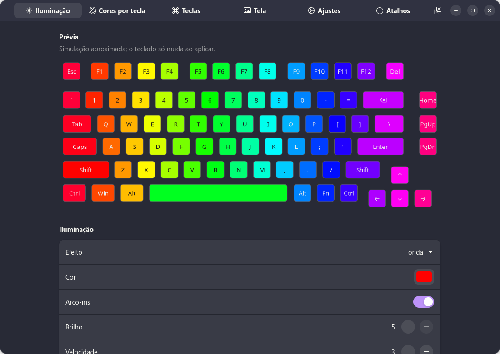
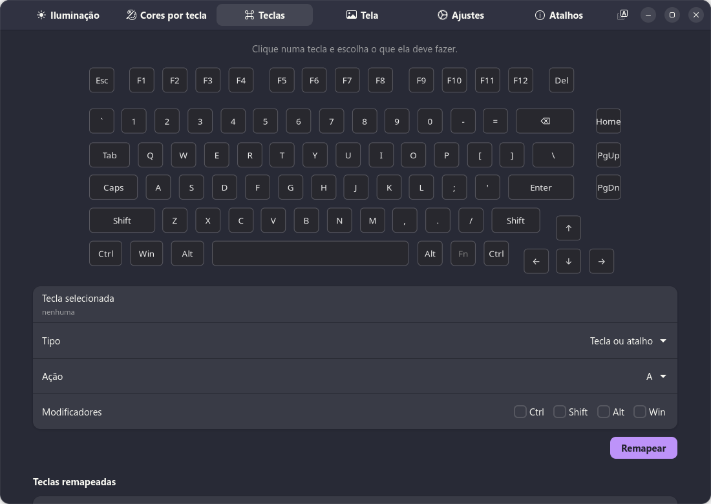
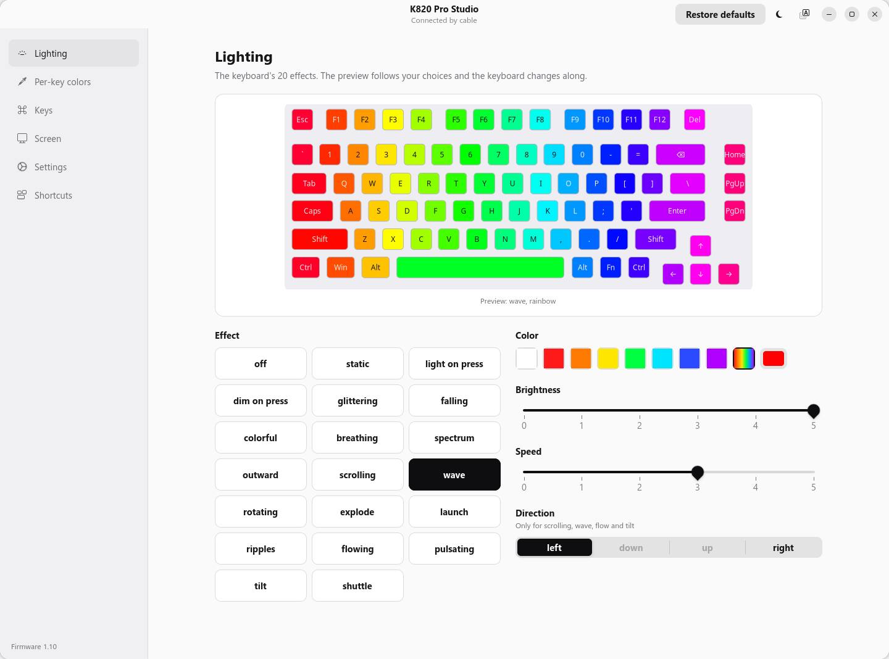

# K820 Pro Studio

[Português](README.md) · **English**

Linux configurator for the **Ajazz AK820 Pro** keyboard (the version with the screen, USB `0c45:800a`), without the manufacturer's Windows software. It has a graphical interface (GTK 4 / libadwaita) and a command line, in **Portuguese, English and Chinese**.



## Contents

- [What it does](#what-it-does)
- [Compatibility](#compatibility)
- [Step-by-step installation](#step-by-step-installation)
- [Using the app](#using-the-app)
- [Command line](#command-line)
- [The keyboard's own shortcuts](#the-keyboards-own-shortcuts)
- [Troubleshooting](#troubleshooting)
- [Uninstalling](#uninstalling)
- [Security and privacy](#security-and-privacy)
- [How it works](#how-it-works)
- [Contributing](#contributing)
- [Credits and license](#credits-and-license)

## What it does

- **Lighting:** the keyboard's 20 effects (wave, breathing, spectrum, rain…), with a single color, rainbow or any color, brightness, speed and direction. An animated preview shows the effect as you change it.
- **Per-key colors:** click keys and paint each one its own color.
- **Keys:** any key (except Fn) can become another key, a shortcut (Ctrl+C, Ctrl+Shift+Esc…) or a multimedia key (volume, play/pause, calculator…).
- **Screen:** send an image or a GIF of up to 140 frames to the little screen, with a preview of how it will look at 128×128.
- **Settings:** sleep time, key response time and the screen clock.
- **Factory reset:** puts everything back the way it came.
- **Shortcuts:** the built-in shortcuts (Fn + key), drawn as keys.
- **Your way:** dark or light theme, in black and white, and the keyboard drawn in your version's colors (grey and yellow, white and purple, black or white).

Everything you change is saved on the keyboard itself and keeps working on Windows, on Mac and wirelessly. Nothing runs in the background.



## Compatibility

| | |
|---|---|
| **Keyboard** | Ajazz AK820 Pro with screen, USB ID `0c45:800a`. Tested with firmware 1.10. The same official software also supports `0c45:8009`, but it was not tested here. |
| **Connection** | **USB cable.** Configuration does not work over the 2.4 GHz dongle or Bluetooth (the wireless protocol has not been studied). Configure over the cable and then go back to wireless: the keyboard remembers everything. |
| **Command line** | Python 3.10 or newer. No dependencies for lighting, keys and settings; Pillow to send images. |
| **App** | GTK 4.16+ and **libadwaita 1.7+**, with PyGObject and pycairo: Fedora 42+, Ubuntu 25.04+, Debian 13+, Arch Linux. |

To check your keyboard's ID, plug in the cable and run `lsusb | grep 0c45`. If it shows `0c45:800a`, this is the one.

## Step-by-step installation

### 1. Install the dependencies

**Fedora**
```sh
sudo dnf install git python3 python3-gobject python3-cairo gtk4 libadwaita python3-pillow
```

**Ubuntu / Debian**
```sh
sudo apt install git python3 python3-gi python3-gi-cairo gir1.2-gtk-4.0 gir1.2-adw-1 python3-pil
```

**Arch Linux**
```sh
sudo pacman -S git python python-gobject python-cairo gtk4 libadwaita python-pillow
```

Only going to use the command line? `git` and `python3` are enough (plus Pillow if you want to send images).

### 2. Get the project

```sh
git clone https://github.com/Fabricio-odn/k820-pro
cd k820-pro
```

### 3. Give your user access to the keyboard

```sh
sudo bash scripts/instalar-udev.sh
```

Then **unplug and replug the keyboard cable**. This is a one-time step. The rule only opens the keyboard's configuration channels, and only to whoever is logged in on the machine (see [Security and privacy](#security-and-privacy)).

### 4. Add the app to the menu (optional)

```sh
bash scripts/instalar-atalho.sh
```

**K820 Pro Studio** shows up in the app grid, with its icon. No `sudo` needed. If you move the project folder, run it again.

### 5. Open it

From the menu, or in a terminal from inside the project folder:

```sh
python3 -m k820_pro.gui.app
```

The header should say **"Connected by cable"**. If it says "Disconnected", see [Troubleshooting](#troubleshooting).

### Updating

```sh
cd k820-pro
git pull
```

If an update changes the udev rule (the commit messages say so), run step 3 again.

### Installing as a system command (optional)

If you prefer `k820` and `k820-gui` commands in the terminal, use `pipx` with access to system packages (PyGObject comes from the system):

```sh
pipx install --system-site-packages .
bash scripts/instalar-atalho.sh   # the menu entry now uses k820-gui
```

## Using the app

| Page | What it does |
|---|---|
| **Lighting** | Pick the effect from the grid and the color from the palette (the gradient square is rainbow; the last one opens a picker for any color), then set brightness, speed and direction. The keyboard updates by itself a moment after you stop changing things. |
| **Per-key colors** | Click keys to select them (click again to deselect), pick a color and use **Paint selected**. Painting switches the keyboard to the custom lighting mode. |
| **Keys** | Click a key and choose the **Type**: factory default, key or shortcut (with Ctrl, Shift, Alt and Win), or multimedia. The change is sent right away. Remapped keys get a dashed outline and appear in the list, with a button to undo. |
| **Screen** | **Choose file…**, check the preview, choose **Fill** (cropped to fill the screen) or **Whole image** (with bars), then **Send to screen**. It takes about 20 seconds; don't unplug the cable halfway. |
| **Settings** | Sleep time, key response time (level 1 is the fastest; raise it if a key repeats on its own), your keyboard version (only changes the drawing in the app) and the screen clock sync. |
| **Shortcuts** | The built-in shortcuts, for reference. |

In the header:
- **Restore defaults** resets the keyboard to factory settings (it asks first).
- The **sun/moon** button switches between dark and light theme.
- The **language** button switches between Portuguese, English and Chinese (applied when the app reopens).

The app keeps what you saved (remapped keys, colors and settings) in `~/.config/k820-pro/estado.json`, because the keyboard receives those tables whole on every change and has no way to send them back. Interface preferences (theme, version and language) live in `~/.config/k820-pro/preferencias.json`.



## Command line

Everything the app does can also be done in a terminal, from inside the project folder (or with `k820`, if you installed through `pipx`). Commands have English aliases:

```sh
python3 -m k820_pro light onda --arco-iris -d direita    # lighting effect
python3 -m k820_pro light estatico -c 00aaff -b 4        # solid blue, brightness 4
python3 -m k820_pro colors --todas 202020 esc=ff0000 f1=00ff00
python3 -m k820_pro key capslock ctrl_esq                # Caps Lock becomes Ctrl
python3 -m k820_pro key f12 ctrl_esq+shift_esq+esc       # shortcut
python3 -m k820_pro key f9 play-pause                    # multimedia
python3 -m k820_pro key capslock padrao                  # undo
python3 -m k820_pro screen ~/Pictures/cat.gif [--encaixar]
python3 -m k820_pro settings --sono 30 --resposta 1
python3 -m k820_pro clock
python3 -m k820_pro reset
python3 -m k820_pro info                                 # where the keyboard is and what is saved
```

Reference lists: `effects`, `keys` (key names), `actions` (what a key can become) and `shortcuts`. Every command has `--help`.

Effect, key and option names are Portuguese identifiers (for example `onda` = wave, `ctrl_esq` = left Ctrl, `padrao` = default). `effects` lists each effect with its English name, and `keys` and `actions` list the valid identifiers. Messages follow the system language; to force one, set `K820_IDIOMA=en`, `pt` or `zh`.

## The keyboard's own shortcuts

These work without any software (source: AK820 Pro manual; some batches change the F row):

| Combination | Function |
|---|---|
| Fn + \\ | Cycle through the 20 lighting effects |
| Fn + ↑ / ↓ | Brightness |
| Fn + + / - | Effect speed |
| Fn + → / ← | Effect direction / color |
| Fn + X | Backlight on / off |
| Fn + Q / W / E | Bluetooth 1, 2, 3 (hold 3 s to pair) |
| Fn + R | 2.4 GHz (hold 3 s to pair) |
| Fn + Win | Lock the Windows key |
| Fn + Home / Del | Screen animation / screen on and off |
| Fn + press the knob | Screen menu (including Windows/Mac, under System) |
| Fn + Space (3 to 5 s) | Factory reset |

The full list, with the F row on Windows and Mac, is on the app's **Shortcuts** page or in `python3 -m k820_pro shortcuts`.

## Troubleshooting

**"Disconnected" / "Keyboard not found"**
- Use the **USB cable**; it does not work over the dongle or Bluetooth.
- Check the ID: `lsusb | grep 0c45` should show `0c45:800a`. A different ID is a different model, not supported yet.

**"no permission on /dev/hidraw…"**
- Run `sudo bash scripts/instalar-udev.sh` and **replug the cable**.
- Still failing? Check that the rule is there: `ls /etc/udev/rules.d/ | grep ajazz` should list `69-ajazz-ak820.rules`.

**The app does not open: error about `Adw`, `ToggleGroup` or `gi`**
- The system UI libraries are missing or too old: install the dependencies from step 1. libadwaita 1.7+ is required (`rpm -q libadwaita` or `apt policy libadwaita-1-0`).

**The icon does not show in the menu**
- Run `bash scripts/instalar-atalho.sh` again (it rebuilds the icon cache). If it persists, log out and back in.

**Sending an image fails with a Pillow error**
- Install `python3-pillow` (Fedora), `python3-pil` (Debian/Ubuntu) or `python-pillow` (Arch).

**The keyboard behaves strangely after a change**
- **Restore defaults** in the app, `python3 -m k820_pro reset`, or on the keyboard itself: Fn + Space for 3 to 5 seconds.

**A key repeats on its own (chatter)**
- In **Settings**, raise the key response time to level 3 or higher.

## Uninstalling

```sh
bash scripts/instalar-atalho.sh --remover          # remove from the menu
sudo bash scripts/instalar-udev.sh --remover       # remove the udev rule
rm -rf ~/.config/k820-pro                          # delete what the app saved
rm -rf k820-pro                                    # the project folder
```

If you installed through `pipx`: `pipx uninstall k820-pro`. Whatever was saved on the keyboard stays there; to go back to defaults, use **Restore defaults** before uninstalling, or Fn + Space.

## Security and privacy

- **No network, no root, no background service.** The program only talks to the keyboard and to the `~/.config/k820-pro` folder.
- **Configuration channels only.** The udev rule gives the logged-in user (`uaccess`) access to the keyboard's interfaces 2 and 3 only. The interface that carries what you type is never opened.
- **Fixes a system hole.** The `libgphoto2` database, shipped with Fedora and Ubuntu, mistakes this keyboard for a camera, so systemd lets any program running as your user read what you type. The project's rule undoes that. **It is worth installing even if you don't use the program.** Details in [SECURITY.md](SECURITY.md) (in Portuguese).
- **Validated input.** Images go through size, pixel and frame limits before being read; configuration files are checked and, if anything looks off, the app falls back to defaults.
- **Known bytes only.** The program only sends the keyboard sequences that the official software also sends, checked byte by byte by the tests.

Found a security issue? Use "Report a vulnerability" in the repository's Security tab.

## How it works

The protocol was worked out by running the official Windows software (`DeviceDriver.exe` 1.0.0.5) on Linux under **Wine**, with a library loaded through `LD_PRELOAD` that logs every packet exchanged with the keyboard (`scripts/captura/`). The recordings are in `captures/`, and the whole protocol is documented in [docs/protocolo.md](docs/protocolo.md) (in Portuguese).

In short: configuration goes through 64-byte *feature reports* on interface 3 (lighting, a 144-key table for remapping and colors, settings, clock), and the screen image goes in 4096-byte blocks through interface 2, as 128×128 RGB565 frames.

The code:

| File | Role |
|---|---|
| `k820_pro/protocolo.py` | builds the packets (never touches hardware) |
| `k820_pro/dispositivo.py` | finds the keyboard and talks to it through hidraw |
| `k820_pro/servico.py` | complete operations (apply lighting, remap, send image…) |
| `k820_pro/cli.py` | command line |
| `k820_pro/gui/` | the app: window, pages, components and themes |
| `k820_pro/i18n.py` | translations |

## Contributing

```sh
python3 -m pytest -q        # run the tests (needs pytest)
```

- The tests in `tests/test_capturas.py` compare what the program builds with what the official software sent. Any protocol change must keep them passing.
- **Never send the keyboard bytes that were not observed** from the official software. To discover a new function, capture with `scripts/captura/capturar.sh <DeviceDriver.exe folder> <output.log>`, do the action in the official app and compare.
- Every UI string goes through `t()` and needs English and Chinese translations; `tests/test_i18n.py` checks it.
- Code comments and docs are in Portuguese; issues and pull requests in English are welcome.
- Different version or ID? Open an issue with the output of `lsusb -v -d 0c45:` (without serial numbers).

## Credits and license

The [gohv/EPOMAKER-Ajazz-AK820-Pro](https://github.com/gohv/EPOMAKER-Ajazz-AK820-Pro) project (MIT) was the starting point; the final protocol came from captures of the official software. The shortcut list comes from the AK820 Pro manual.

Independent project, not affiliated with Ajazz or with the makers of the official software. Names and trademarks belong to their owners. Use at your own risk. [MIT](LICENSE) license.
