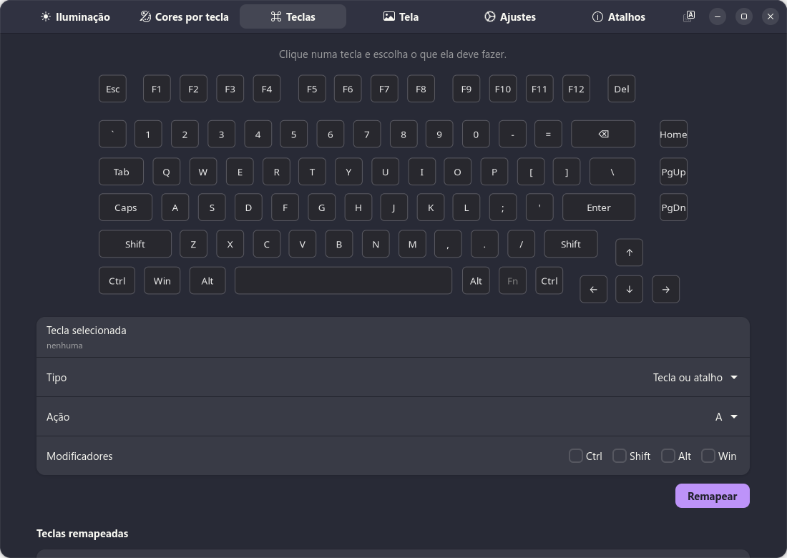
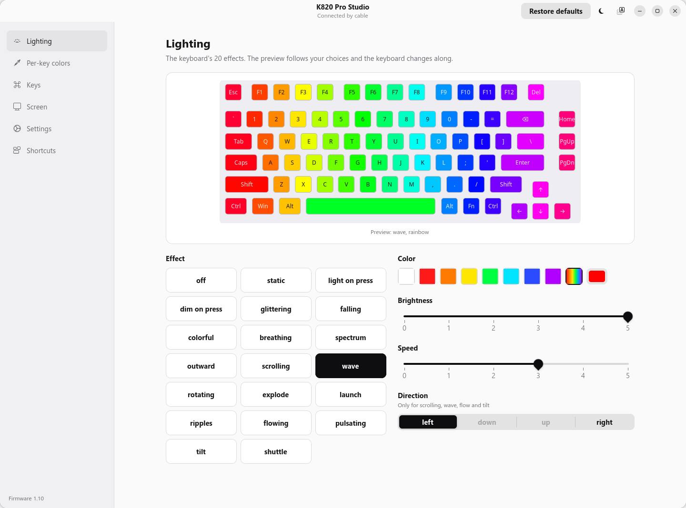

# K820 Pro Studio

**Português** · [English](README.en.md)

Configurador do teclado **Ajazz AK820 Pro** (a versão com tela, USB `0c45:800a`) para Linux, sem o software de Windows do fabricante. Tem interface gráfica (GTK 4 / libadwaita) e linha de comando, em **português, inglês e chinês**.


## Sumário

- [O que dá para fazer](#o-que-dá-para-fazer)
- [Compatibilidade](#compatibilidade)
- [Instalação passo a passo](#instalação-passo-a-passo)
- [Usando a interface](#usando-a-interface)
- [Linha de comando](#linha-de-comando)
- [Atalhos do próprio teclado](#atalhos-do-próprio-teclado)
- [Problemas comuns](#problemas-comuns)
- [Desinstalar](#desinstalar)
- [Segurança e privacidade](#segurança-e-privacidade)
- [Como funciona](#como-funciona)
- [Para quem quer contribuir](#para-quem-quer-contribuir)
- [Créditos e licença](#créditos-e-licença)

## O que dá para fazer

- **Iluminação:** os 20 efeitos do teclado (onda, respiração, espectro, chuva…), com cor única, arco-íris ou qualquer cor, brilho, velocidade e direção. Uma prévia animada mostra o efeito antes de você mexer no teclado.
- **Cores por tecla:** clique nas teclas e pinte cada uma de uma cor.
- **Teclas:** qualquer tecla (menos a Fn) vira outra tecla, um atalho (Ctrl+C, Ctrl+Shift+Esc…) ou uma tecla multimídia (volume, tocar/pausar, calculadora…).
- **Tela:** manda uma imagem ou um GIF de até 140 quadros para a telinha, com prévia de como vai ficar em 128×128.
- **Ajustes:** tempo até o teclado dormir, tempo de resposta das teclas e acerto do relógio da tela.
- **Padrão de fábrica:** volta tudo como veio da loja.
- **Atalhos:** a lista dos atalhos de fábrica (Fn + tecla) desenhados como teclas.
- **Do seu jeito:** tema escuro ou claro, em preto e branco, e o desenho do teclado na cor da sua versão (cinza e amarelo, branco e roxo, preto ou branco).

Tudo o que você muda fica gravado no próprio teclado e continua valendo no Windows, no Mac e sem fio. Não fica nada rodando em segundo plano.



## Compatibilidade

| | |
|---|---|
| **Teclado** | Ajazz AK820 Pro com tela, ID USB `0c45:800a`. Testado com firmware 1.10. O mesmo software oficial atende o `0c45:8009`, mas ele não foi testado aqui. |
| **Conexão** | **Cabo USB** ou **dongle 2.4 GHz** (`0c45:fdfd`). Pelo dongle funciona tudo, menos a **tela** e a **restauração de fábrica**, que só vão pelo cabo (o próprio software oficial é assim). **Bluetooth não**: o software oficial também não configura por ele. Com cabo e dongle ligados, o programa usa o cabo. |
| **Linha de comando** | Python 3.10 ou mais novo. Nenhuma dependência para luz, teclas e ajustes; o Pillow para mandar imagens. |
| **Interface** | GTK 4.16+ e **libadwaita 1.7+**, com PyGObject e pycairo: Fedora 42+, Ubuntu 25.04+, Debian 13+, Arch Linux. |

Para descobrir o ID do seu teclado, ligue o cabo e rode `lsusb | grep 0c45`. Se aparecer `0c45:800a`, é este.

## Instalação passo a passo

### 1. Instale as dependências

**Fedora**
```sh
sudo dnf install git python3 python3-gobject python3-cairo gtk4 libadwaita python3-pillow
```

**Ubuntu / Debian**
```sh
sudo apt install git python3 python3-gi python3-gi-cairo gir1.2-gtk-4.0 gir1.2-adw-1 python3-pil
```

**Arch Linux**
```sh
sudo pacman -S git python python-gobject python-cairo gtk4 libadwaita python-pillow
```

Só vai usar a linha de comando? Basta o `git` e o `python3` (e o Pillow, se quiser mandar imagens).

### 2. Baixe o projeto

```sh
git clone https://github.com/Fabricio-odn/k820-pro
cd k820-pro
```

### 3. Libere o teclado para o seu usuário

```sh
sudo bash scripts/instalar-udev.sh
```

Depois **desconecte e reconecte o cabo do teclado e o dongle**. Isso é feito uma vez só. A regra libera apenas os canais de configuração do teclado e do dongle, e só para quem está logado na máquina (veja [Segurança e privacidade](#segurança-e-privacidade)).

### 4. Coloque o app no menu (opcional)

```sh
bash scripts/instalar-atalho.sh
```

O **K820 Pro Studio** aparece na lista de aplicativos, com ícone. Não precisa de `sudo`. Se você mover a pasta do projeto, rode de novo.

### 5. Abra

Pelo menu, ou no terminal, de dentro da pasta do projeto:

```sh
python3 -m k820_pro.gui.app
```

O cabeçalho deve mostrar **"Conectado pelo cabo"** ou **"Conectado pelo dongle 2.4 GHz"**. Se mostrar "Desconectado", veja [Problemas comuns](#problemas-comuns).

### Para atualizar

```sh
cd k820-pro
git pull
```

Se a atualização mexer na regra udev (o changelog dos commits avisa), rode o passo 3 de novo.

### Instalar como comando do sistema (opcional)

Se preferir os comandos `k820` e `k820-gui` no terminal, use o `pipx` com acesso aos pacotes do sistema (o PyGObject vem do sistema):

```sh
pipx install --system-site-packages .
bash scripts/instalar-atalho.sh   # o atalho passa a usar o k820-gui
```

## Usando a interface

| Página | O que faz |
|---|---|
| **Iluminação** | Escolha o efeito na grade, a cor na paleta (o quadrado com gradiente é o arco-íris; o último abre o seletor de qualquer cor), e ajuste brilho, velocidade e direção. O teclado muda sozinho, uma fração de segundo depois de você parar de mexer. |
| **Cores por tecla** | Clique nas teclas para selecionar (clique de novo para tirar), escolha a cor e use **Pintar selecionadas**. Ao pintar, o teclado entra no modo de luz personalizada. |
| **Teclas** | Clique numa tecla e escolha o **Tipo**: padrão de fábrica, tecla ou atalho (com Ctrl, Shift, Alt e Win), ou multimídia. A troca vai para o teclado na hora. As teclas remapeadas ficam marcadas com contorno tracejado e aparecem na lista, com um botão para desfazer. |
| **Tela** | **Escolher arquivo…**, confira a prévia, escolha entre **Preencher** (corta para ocupar a tela) e **Imagem inteira** (com faixas) e clique em **Enviar para a tela**. Leva uns 20 segundos; não desligue o cabo no meio. |
| **Ajustes** | Tempo até dormir, tempo de resposta das teclas (nível 1 é o mais rápido; suba se alguma tecla repetir sozinha), a versão do seu teclado (só muda o desenho no programa) e o acerto do relógio da tela. |
| **Atalhos** | Os atalhos de fábrica, para consulta. |

No cabeçalho:
- **Restaurar padrão** volta o teclado ao padrão de fábrica (pede confirmação).
- O **sol/lua** troca entre tema escuro e claro.
- O botão de **idioma** troca entre português, inglês e chinês (vale ao reabrir o app).

O programa guarda o que você gravou (teclas remapeadas, cores e ajustes) em `~/.config/k820-pro/estado.json`, porque o teclado recebe essas tabelas inteiras a cada mudança e não tem como devolver o que tem. As preferências da interface (tema, versão e idioma) ficam em `~/.config/k820-pro/preferencias.json`.



## Linha de comando

Tudo o que a interface faz também dá para fazer no terminal, de dentro da pasta do projeto (ou com `k820`, se instalou pelo `pipx`):

```sh
python3 -m k820_pro luz onda --arco-iris -d direita       # efeito de luz
python3 -m k820_pro luz estatico -c 00aaff -b 4           # azul fixo, brilho 4
python3 -m k820_pro cores --todas 202020 esc=ff0000 f1=00ff00
python3 -m k820_pro tecla capslock ctrl_esq               # Caps Lock vira Ctrl
python3 -m k820_pro tecla f12 ctrl_esq+shift_esq+esc      # atalho
python3 -m k820_pro tecla f9 play-pause                   # multimídia
python3 -m k820_pro tecla capslock padrao                 # desfaz
python3 -m k820_pro tela ~/Imagens/gato.gif [--encaixar]
python3 -m k820_pro ajustes --sono 30 --resposta 1
python3 -m k820_pro relogio
python3 -m k820_pro restaurar
python3 -m k820_pro info                                  # onde o teclado está e o que está gravado
```

Listas de consulta: `efeitos`, `teclas` (nomes das teclas), `acoes` (o que uma tecla pode virar) e `atalhos`. Cada comando tem `--help`.

Os comandos têm apelidos em inglês (`light`, `colors`, `key`, `keys`, `actions`, `screen`, `settings`, `clock`, `reset`, `shortcuts`, `effects`). O idioma das mensagens segue o do sistema; para forçar, use `K820_IDIOMA=pt`, `en` ou `zh`.

## Atalhos do próprio teclado

Funcionam sem programa nenhum (fonte: manual do AK820 Pro; alguns lotes mudam a fileira F):

| Combinação | Função |
|---|---|
| Fn + \\ | Troca entre os 20 efeitos de luz |
| Fn + ↑ / ↓ | Brilho |
| Fn + + / - | Velocidade do efeito |
| Fn + → / ← | Direção / cor do efeito |
| Fn + X | Liga / desliga a luz |
| Fn + Q / W / E | Bluetooth 1, 2, 3 (segure 3 s para parear) |
| Fn + R | 2.4 GHz (segure 3 s para parear) |
| Fn + Win | Trava a tecla Windows |
| Fn + Home / Del | Animação da tela / liga e desliga a tela |
| Fn + apertar o botão giratório | Menu da tela (inclusive Windows/Mac, em System) |
| Fn + Espaço (3 a 5 s) | Padrão de fábrica |

A lista completa, com a fileira F no Windows e no Mac, está na página **Atalhos** do app ou em `python3 -m k820_pro atalhos`.

## Problemas comuns

**"Desconectado" / "Teclado não encontrado"**
- Ligue o **cabo USB** ou o **dongle 2.4 GHz**; por Bluetooth não funciona.
- Confira os IDs: `lsusb | grep 0c45` deve mostrar `0c45:800a` (cabo) ou `0c45:fdfd` (dongle). Outro ID é outro modelo, ainda não suportado.

**"O teclado não respondeu pelo dongle"**
- O teclado está dormindo ou em outro modo: aperte uma tecla e tente de novo, e confira se ele está no 2.4 GHz (Fn + R). Com o sono em 1 minuto, ele dorme rápido; mude para 5 ou 30 em **Ajustes**.

**A tela ou o "Restaurar padrão" não funcionam**
- Pelo dongle eles não existem (nem no software oficial). Ligue o cabo; para restaurar sem cabo, segure Fn + Espaço por 3 a 5 segundos.

**"sem permissão em /dev/hidraw…"**
- Rode `sudo bash scripts/instalar-udev.sh` e **reconecte o cabo**.
- Ainda assim? Confira se a regra está lá: `ls /etc/udev/rules.d/ | grep ajazz` deve mostrar `69-ajazz-ak820.rules`.

**O app não abre: erro sobre `Adw`, `ToggleGroup` ou `gi`**
- Falta a interface do sistema ou ela é velha demais: instale as dependências do passo 1. É preciso libadwaita 1.7+ (`rpm -q libadwaita` ou `apt policy libadwaita-1-0`).

**O ícone não aparece no menu**
- Rode `bash scripts/instalar-atalho.sh` de novo (ele refaz o cache de ícones). Se continuar, saia da sessão e entre de novo.

**Mandar imagem dá erro sobre o Pillow**
- Instale `python3-pillow` (Fedora), `python3-pil` (Debian/Ubuntu) ou `python-pillow` (Arch).

**O teclado ficou estranho depois de alguma mudança**
- **Restaurar padrão** no app, `python3 -m k820_pro restaurar`, ou no próprio teclado: Fn + Espaço por 3 a 5 segundos.

**Uma tecla repete sozinha (chatter)**
- Em **Ajustes**, suba o tempo de resposta das teclas para o nível 3 ou mais.

## Desinstalar

```sh
bash scripts/instalar-atalho.sh --remover          # tira do menu
sudo bash scripts/instalar-udev.sh --remover       # tira a regra udev
rm -rf ~/.config/k820-pro                          # apaga o que o app guardou
rm -rf k820-pro                                    # a pasta do projeto
```

Se instalou pelo `pipx`: `pipx uninstall k820-pro`. O que foi gravado no teclado continua lá; para voltar ao padrão, use **Restaurar padrão** antes de desinstalar ou Fn + Espaço.

## Segurança e privacidade

- **Sem rede, sem root, sem serviço em segundo plano.** O programa só fala com o teclado e com a pasta `~/.config/k820-pro`.
- **Só os canais de configuração.** A regra udev libera para o usuário logado (`uaccess`) apenas as interfaces 2 e 3 do teclado e 3 e 4 do dongle. As interfaces por onde passa o que você digita nunca são abertas.
- **Corrige um furo do sistema.** O banco de dados do `libgphoto2`, que vem no Fedora e no Ubuntu, confunde este teclado com uma câmera, e por isso o systemd libera a leitura do que é digitado para qualquer programa do seu usuário. A regra do projeto desfaz isso. **Vale instalá-la mesmo se você não for usar o programa.** Detalhes em [SECURITY.md](SECURITY.md).
- **Entradas validadas.** Imagens passam por limites de tamanho, pixels e quadros antes de serem lidas; os arquivos de configuração são conferidos e, se estiverem estranhos, o app volta aos padrões.
- **Só bytes conhecidos.** O programa manda ao teclado apenas sequências que o software oficial também manda, conferidas byte a byte pelos testes.

Encontrou um problema de segurança? Use "Report a vulnerability" na aba Security do repositório.

## Como funciona

O protocolo foi descoberto rodando o software oficial de Windows (`DeviceDriver.exe` 1.0.0.5) no Linux pelo **Wine**, com uma biblioteca carregada via `LD_PRELOAD` que registra cada pacote trocado com o teclado (`scripts/captura/`). As gravações estão em `captures/`, e o protocolo inteiro está descrito em [docs/protocolo.md](docs/protocolo.md).

Resumo: pelo cabo, a configuração é feita por *feature reports* de 64 bytes na interface 3 (iluminação, tabela de 144 teclas para remapeamento e cores, ajustes, relógio), e a imagem da tela vai em blocos de 4096 bytes pela interface 2, quadros de 128×128 em RGB565. Pelo dongle, os mesmos dados vão em pacotes de 32 bytes com soma de verificação na interface 3 do dongle, e o teclado confirma cada um.

O código:

| Arquivo | Papel |
|---|---|
| `k820_pro/protocolo.py` | monta os pacotes (sem tocar no hardware) |
| `k820_pro/dispositivo.py` | acha o teclado e fala com ele pelo hidraw |
| `k820_pro/servico.py` | operações completas (aplicar luz, remapear, enviar imagem…) |
| `k820_pro/cli.py` | linha de comando |
| `k820_pro/gui/` | interface: janela, páginas, componentes e temas |
| `k820_pro/i18n.py` | traduções |

## Para quem quer contribuir

```sh
python3 -m pytest -q        # roda os testes (precisa do pytest)
```

- Os testes em `tests/test_capturas.py` comparam o que o programa monta com o que o software oficial mandou. Qualquer mudança no protocolo precisa continuar passando neles.
- **Nunca mande ao teclado bytes que não foram observados** no software oficial. Para descobrir uma função nova, capture com `scripts/captura/capturar.sh <pasta do DeviceDriver.exe> <saída.log>`, faça a ação no programa oficial e compare.
- Todo texto da interface passa por `t()` e precisa de tradução em inglês e chinês; o `tests/test_i18n.py` confere.
- Seu teclado é de outra versão ou tem outro ID? Abra uma issue com a saída de `lsusb -v -d 0c45:` (sem número de série).

## Créditos e licença

O projeto [gohv/EPOMAKER-Ajazz-AK820-Pro](https://github.com/gohv/EPOMAKER-Ajazz-AK820-Pro) (MIT) foi o ponto de partida; o protocolo final veio das capturas do software oficial. A lista de atalhos vem do manual do AK820 Pro.

Projeto independente, sem relação com a Ajazz nem com quem fez o software oficial. Os nomes e as marcas pertencem aos donos. Use por sua conta e risco. Licença [MIT](LICENSE).
