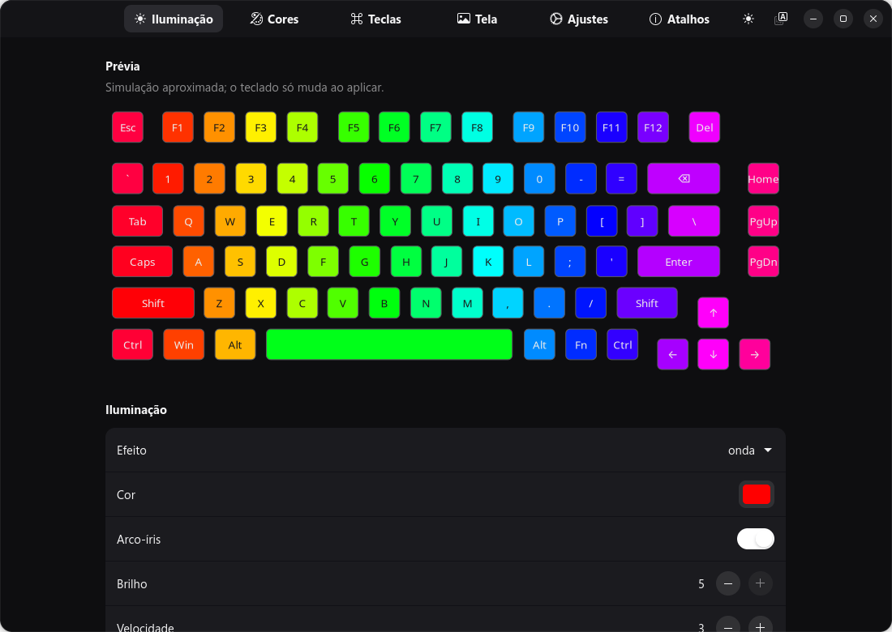

# K820 Pro Studio

Configurador do teclado **Ajazz AK820 Pro** (USB `0c45:800a`, a versão com tela) para Linux, sem o software de Windows do fabricante. Tem interface gráfica (GTK 4) e linha de comando, em **português, inglês e chinês**.

*English: Linux configurator for the Ajazz AK820 Pro keyboard (lighting, per-key colors, key remapping, screen GIF, sleep/response settings, clock, factory reset). GUI and CLI in Portuguese, English and Chinese. CLI commands have English aliases (`k820 light`, `k820 key`, `k820 screen`…); run with `K820_IDIOMA=en`.*

*中文：在 Linux 上配置 Ajazz AK820 Pro 键盘（灯光、单键颜色、按键映射、屏幕 GIF、休眠和响应时间、时钟、恢复出厂）。图形界面和命令行支持中文（`K820_IDIOMA=zh`）。*



## O que dá para fazer

- **Iluminação:** os 20 efeitos, cor única ou arco-íris, brilho, velocidade e direção, com prévia animada.
- **Cores por tecla:** clique nas teclas e pinte cada uma de uma cor.
- **Teclas:** qualquer tecla (menos Fn) vira outra tecla, um atalho (Ctrl+C) ou uma tecla multimídia.
- **Tela:** imagem ou GIF (até 140 quadros), com prévia de como vai ficar em 128×128.
- **Ajustes:** tempo até dormir, tempo de resposta das teclas, relógio da tela e padrão de fábrica.
- **Atalhos:** a lista dos atalhos de fábrica (Fn + tecla), que funcionam sem programa nenhum.
- **Do seu jeito:** tema escuro ou claro, em preto e branco, e o desenho do teclado na cor da sua versão (cinza e amarelo, branco e roxo, preto ou branco).


O protocolo foi descoberto rodando o software oficial no Wine e registrando o que ele manda ao teclado (veja [docs/protocolo.md](docs/protocolo.md)). A ferramenta só manda sequências que o software oficial também manda, e os testes conferem byte a byte que ela reproduz as gravações.

## Compatibilidade

- Testado no AK820 Pro ANSI com tela, ID USB `0c45:800a`, ligado **pelo cabo**. O mesmo software oficial atende o `0c45:8009`, mas ele não foi testado aqui.
- Pelo dongle 2.4G ou Bluetooth a configuração não funciona (protocolo não estudado); use o cabo para configurar, depois pode voltar ao sem fio, porque o teclado guarda tudo.
- Linha de comando: Python 3.10+, sem dependências. Imagens: Pillow. Interface: GTK 4 e libadwaita 1.5+ com PyGObject (Fedora 40+, Ubuntu 24.04+).

## Instalação

```sh
git clone https://github.com/Fabricio-odn/k820-pro
cd k820-pro
sudo bash scripts/instalar-udev.sh    # libera o teclado para o seu usuário (uma vez)
bash scripts/instalar-atalho.sh       # opcional: "K820 Pro Studio" no menu de aplicativos
```

No Fedora, as dependências da interface: `sudo dnf install python3-gobject libadwaita python3-pillow`. No Debian/Ubuntu: `sudo apt install python3-gi gir1.2-adw-1 python3-pil`.

Para abrir a interface: `python3 -m k820_pro.gui.app`. Com `pip install --user .` viram os comandos `k820-gui` e `k820`.

## Linha de comando

```sh
python3 -m k820_pro luz onda --arco-iris -d direita
python3 -m k820_pro cores --todas 202020 esc=ff0000 f1=00ff00
python3 -m k820_pro tecla capslock ctrl_esq        # e "padrao" para desfazer
python3 -m k820_pro tela ~/Imagens/gato.gif
python3 -m k820_pro ajustes --sono 30 --resposta 1
python3 -m k820_pro relogio
python3 -m k820_pro restaurar
python3 -m k820_pro atalhos | efeitos | teclas | acoes
```

O que foi gravado no teclado fica em `~/.config/k820-pro/estado.json`, porque as tabelas de teclas e de cores vão inteiras a cada mudança e o teclado não devolve o que tem.

## Segurança e privacidade

- Não usa rede, não roda como root e não tem serviço em segundo plano.
- A regra udev libera **só** as interfaces de configuração (2 e 3) do `0c45:800a`, e só para quem está logado na máquina (`uaccess`). A interface do teclado em si (o que é digitado) nunca é aberta.
- **Instale a regra mesmo sem usar o programa:** o `libgphoto2` confunde este teclado com uma câmera, e o systemd acaba liberando a leitura do que é digitado para qualquer programa do usuário. A regra do projeto fecha isso (detalhes no [SECURITY.md](SECURITY.md)).
- Arquivos de imagem passam por limites de tamanho, de pixels e de quadros antes de serem lidos.
- Detalhes e como relatar problemas: [SECURITY.md](SECURITY.md).

## Créditos

O projeto [gohv/EPOMAKER-Ajazz-AK820-Pro](https://github.com/gohv/EPOMAKER-Ajazz-AK820-Pro) (MIT) foi o ponto de partida; o protocolo final veio das capturas do software oficial. A lista de atalhos vem do manual do AK820 Pro. 
Projeto independente, sem relação com a Ajazz nem com quem fez o software oficial. Os nomes e as marcas pertencem aos donos. Use por sua conta e risco (licença [MIT](LICENSE)).
